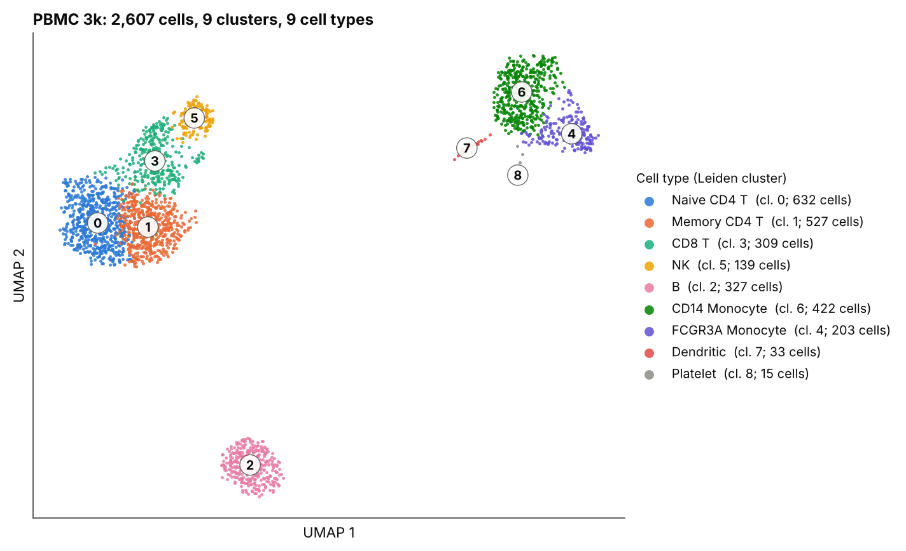
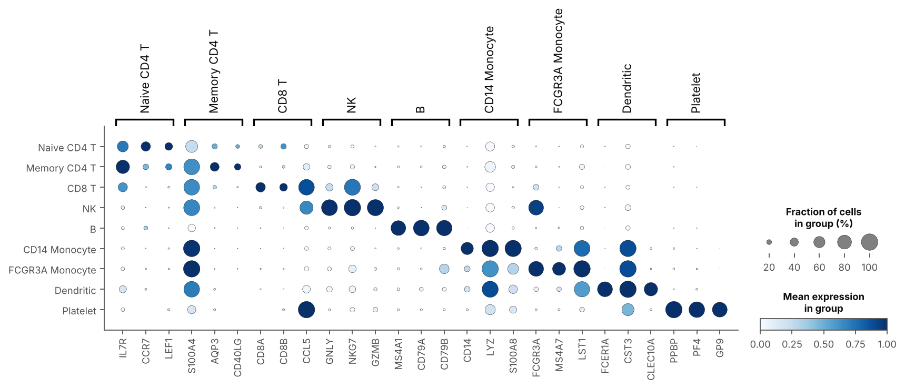
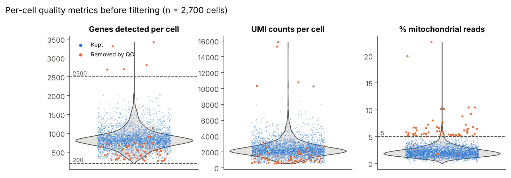
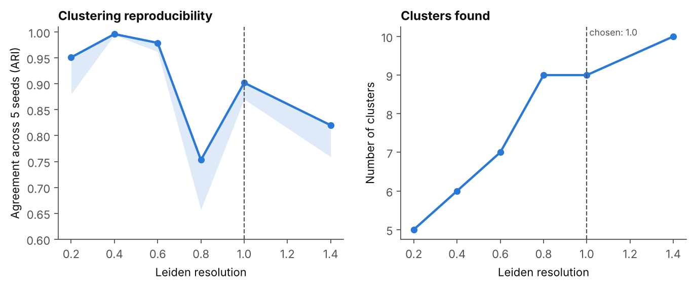

# Single-Cell RNA-seq Analysis of 3k PBMCs (Scanpy)

An end-to-end single-cell RNA sequencing analysis in Python: quality control, doublet removal, normalization, clustering, marker gene discovery and cell type annotation of about 2,700 human blood immune cells. The pipeline runs with one command and writes every figure and results table, and a Jupyter notebook walks through the same steps with the reasoning behind each decision.



## Why this project

Single-cell RNA-seq measures which genes are switched on in each individual cell, so a blood sample can be split into its separate immune cell populations instead of being averaged together. I used the 10x Genomics PBMC 3k dataset because its cell types and marker genes are well established, which means every step of the analysis can be checked against known biology rather than just trusted.

I wanted the pipeline to behave the way a data analyst's pipeline should: every threshold written down in one config file, every removed cell counted with a reason, clustering choices backed by a reproducibility check, and low-confidence cell type calls flagged for review instead of silently accepted.

## Results at a glance

| Step | Result |
|---|---|
| Cells loaded | 2,700 cells x 32,738 genes |
| Removed by QC (high mitochondrial reads or too many genes) | 62 cells |
| Removed as predicted doublets (Scrublet) | 31 cells |
| Cells analyzed | **2,607 cells, 13,656 genes** |
| Clusters (Leiden, resolution 1.0) | 9 clusters, reproducible across random seeds (mean ARI 0.90) |
| Cell types identified | 9 |
| Clusters flagged for manual review | 2 (both confirmed after review) |

| Cell type | Cells | % of cells |
|---|---:|---:|
| Naive CD4 T | 632 | 24.2 |
| Memory CD4 T | 527 | 20.2 |
| CD14 Monocyte | 422 | 16.2 |
| B | 327 | 12.5 |
| CD8 T | 309 | 11.9 |
| FCGR3A Monocyte | 203 | 7.8 |
| NK | 139 | 5.3 |
| Dendritic | 33 | 1.3 |
| Platelet | 15 | 0.6 |

The marker dotplot below is the check that the labels make biological sense: each row lights up for its own markers and stays quiet for the others (B cells for MS4A1/CD79A, NK cells for GNLY/NKG7, platelets for PPBP/PF4, and so on).



## Pipeline

| # | Step | What it does | Output |
|---|---|---|---|
| 1 | Load and QC metrics | Reads the raw 10x count matrix; computes genes, UMIs and % mitochondrial reads per cell | `01_qc_distributions.png`, `02_qc_scatter.png` |
| 2 | Filtering | Removes cells with < 200 or > 2,500 genes or > 5% mitochondrial reads; genes seen in < 3 cells; Scrublet doublets. A 5-MAD rule is computed for comparison | `qc_summary.csv` |
| 3 | Normalization and embedding | Normalizes to 10,000 counts per cell, log-transforms, selects 2,000 variable genes, PCA, kNN graph, UMAP | `03_pca_variance.png` |
| 4 | Clustering with a stability check | Leiden clustering at 6 resolutions x 5 seeds; agreement between seeds measured with the adjusted Rand index | `cluster_stability.csv`, `04_cluster_stability.png` |
| 5 | Marker genes | Wilcoxon rank-sum test, each cluster vs. all other cells (adjusted p < 0.05) | `cluster_markers_top10.csv` |
| 6 | Annotation | Scores every cell for 9 canonical PBMC marker sets; each cluster takes its highest-scoring type, and calls that win by less than 0.25 are flagged "review" with the supporting evidence exported | `cluster_annotation.csv`, `annotation_review_evidence.csv`, figures 05-08 |



## Decisions and takeaways

**Choosing the clustering resolution.** The most reproducible resolutions (0.4 to 0.6) merged naive and memory CD4 T cells into one cluster and folded CD8 T cells in with NK cells, even though their marker genes clearly differ. Resolution 1.0 was the lowest setting that separated all expected populations while staying reproducible across seeds (mean ARI 0.90). Resolution 0.8 was a trap: it found the same number of clusters, but a boundary moved from seed to seed (ARI 0.75). Picking a resolution on stability alone, or on cluster count alone, would have given a worse answer than using both together with the biology.



**Reviewing the uncertain calls.** Two clusters were flagged because the top two cell types scored close together:

- **Cluster 0, Naive vs. Memory CD4 T:** mean log expression of CCR7 about 5x and LEF1 about 4x the rest of the data, with roughly half the S100A4. That is the naive T cell pattern, so the call was kept. Naive and memory CD4 T cells form a gradient in this data rather than two clean groups, which is why the score margin was small.
- **Cluster 3, CD8 T vs. NK:** expresses CD8A, CD8B and GZMK, which NK cells lack, while sharing cytotoxic genes (NKG7, CCL5) with NK cells. Call kept as CD8 T.

**QC thresholds.** The fixed thresholds removed 62 cells; a data-driven 5-MAD rule would have flagged 85, a similar but not identical set. Writing both down makes the choice visible instead of hidden in code.

## How to run

```bash
git clone https://github.com/blaketm97/scanpy-pbmc-analysis.git
cd scanpy-pbmc-analysis
python -m venv .venv && source .venv/bin/activate    # Windows: .venv\Scripts\activate
pip install -r requirements.txt

python run_pipeline.py          # about 1 minute; downloads the data on first run
pytest tests                    # quick checks on QC and annotation logic
jupyter lab notebooks/pbmc3k_walkthrough.ipynb
```

On first run the data downloads automatically through `scanpy.datasets.pbmc3k()`. To use the original 10x files instead, extract `pbmc3k_filtered_gene_bc_matrices.tar.gz` from 10x Genomics into `data/raw/` so that `data/raw/filtered_gene_bc_matrices/hg19/matrix.mtx` exists. All thresholds live in `src/pbmc_pipeline/config.py`, and `python run_pipeline.py --resolution 0.6` re-runs at a different clustering resolution.

## Repository layout

```
run_pipeline.py                 one-command pipeline
src/pbmc_pipeline/
    config.py                   every threshold and the marker gene sets
    qc.py                       loading, QC flags, doublet detection
    analysis.py                 normalization, PCA/UMAP, clustering + stability, markers
    annotate.py                 marker-set scoring, confidence flags, review evidence
    plots.py                    figures
notebooks/pbmc3k_walkthrough.ipynb   step-by-step walkthrough with explanations
tests/test_pipeline.py          tests on synthetic data
results/figures/                PNG figures (01-08)
results/tables/                 CSV outputs + run_summary.json (package versions)
data/                           downloaded and processed data (not committed)
```

## Output tables

| File | Columns |
|---|---|
| `qc_summary.csv` | `step`, `count`: cells and genes at each filtering step |
| `cluster_stability.csv` | `resolution`, `n_clusters_median`, `mean_pairwise_ARI`, `min_pairwise_ARI` |
| `cluster_markers_top10.csv` | `leiden`, `gene`, `logfoldchanges`, `pvals_adj`, `pct_in_cluster`, `pct_in_other_cells` |
| `cluster_annotation.csv` | `leiden`, `n_cells`, `cell_type`, `top_score`, `runner_up`, `runner_up_score`, `margin`, `confidence` |
| `annotation_review_evidence.csv` | marker expression in each "review" cluster vs. all other cells, for both candidate cell types |
| `cell_type_counts.csv` | `cell_type`, `n_cells`, `pct_of_cells` |
| `run_summary.json` | headline numbers plus Python and package versions |

## Limitations

- One healthy donor and one sample, so there is no batch correction or comparison between conditions.
- Annotation relies on a curated list of known markers. Rare or activated cell states outside that list get assigned to the closest type. A reference-based annotator such as CellTypist would be a useful cross-check.
- Platelets (15 cells) and dendritic cells (33 cells) are small groups, so their marker statistics are less certain than the large populations.

## Data and tools

- Data: *3k PBMCs from a Healthy Donor*, 10x Genomics (Chromium v1, hg19), freely available from 10x Genomics.
- Tools: Python, Scanpy, AnnData, Scrublet (via Scanpy), leidenalg, scikit-learn, pandas, NumPy, matplotlib, pytest, Jupyter.
